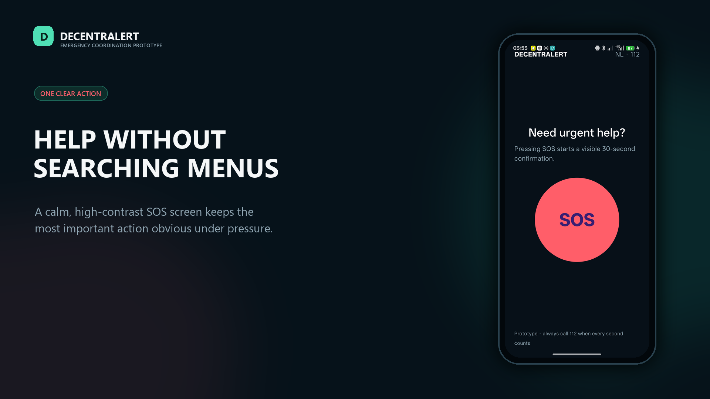
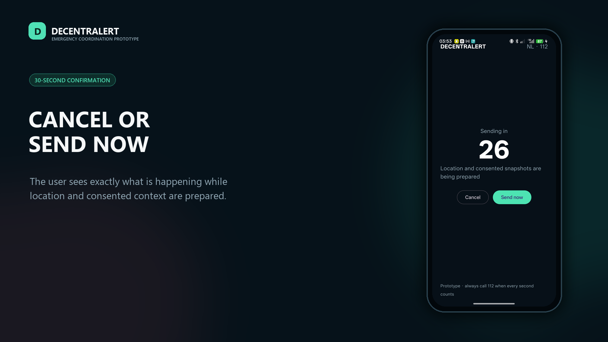
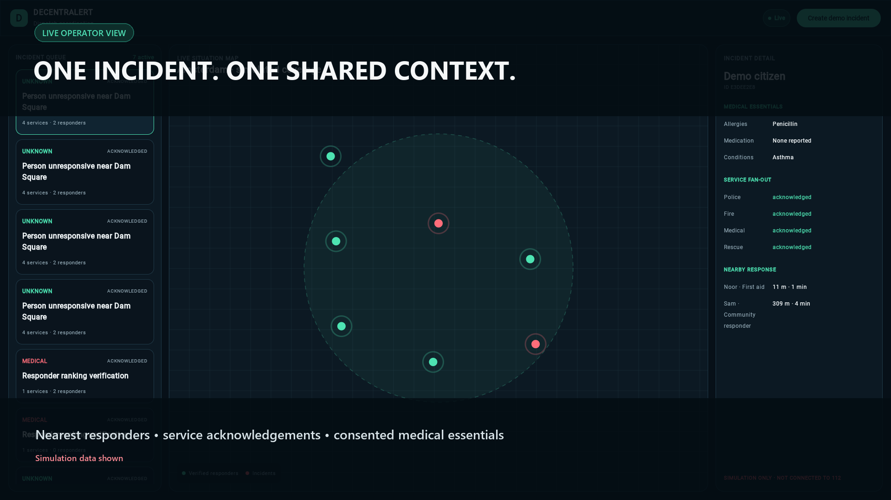
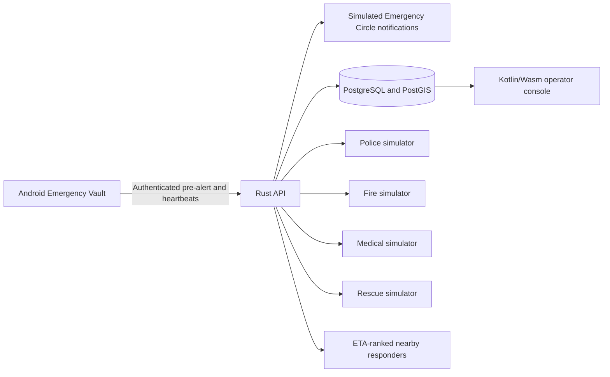

<p align="center">
  
</p>

<h1 align="center">Decentralert</h1>

<p align="center">
  Emergency context and responder coordination, designed for the seconds that matter.
</p>

<p align="center">
  <a href="https://github.com/razecrs/decentralert/releases/latest"><strong>Download the Android judge build</strong></a>
  ·
  <a href="https://decentralert.razecrs.com"><strong>Open the live operator demo</strong></a>
  ·
  <a href="docs/JUDGES.md"><strong>Judge guide</strong></a>
</p>

<p align="center">
  <a href="https://github.com/razecrs/decentralert/actions/workflows/ci.yml"></a>
  <a href="LICENSE"></a>
  
</p>

> [!CAUTION]
> Decentralert is a simulation. It does not contact 112, NL-Alert, or any live emergency service. Always call 112 in a real emergency.

## What it demonstrates

Decentralert explores how one SOS action could give trusted contacts and emergency operators faster, clearer context. A visible 30-second safety window helps prevent accidental alerts. The server stores the pre-alert before confirmation and watches authenticated heartbeats, so an opted-in session can still escalate in the simulation if the phone goes offline. Once confirmed, the concept combines location, emergency type, and only the medical information the user has chosen to share.

The prototype includes:

- An Android Emergency Vault for medical context, accessibility needs, and consent controls
- An Emergency Circle with accepted trusted contacts and simulated call, SMS, and push attempts
- An authenticated SOS pre-alert with Cancel, Send now, and heartbeat-loss escalation
- A Kotlin Multiplatform incident model and deterministic countdown state machine
- A Rust and Axum API with idempotent incident creation and service fan-out simulation
- PostgreSQL and PostGIS persistence with ETA-ranked nearby responders
- A Kotlin/Wasm operator console with incident context and service acknowledgements
- Explicit simulation labels and privacy boundaries throughout the experience

## Try it

### Android judge build

Download the latest APK from [GitHub Releases](https://github.com/razecrs/decentralert/releases/latest).

The judge build is signed with Android's standard debug key so it can be installed directly. It is not signed with a production release key and must not be redistributed as a production application. Android does not permit installation of a truly unsigned APK.

Requirements:

- Android 8.0 or newer
- Permission to install apps from your browser or file manager
- No account required

See the [judge guide](docs/JUDGES.md) for the two-minute walkthrough.

### Operator console

The deployed simulation is available at [decentralert.razecrs.com](https://decentralert.razecrs.com). Select **Create demo incident** to watch the simulated service acknowledgements and responder ranking update, or create a test profile in the Android build and send a simulated SOS session to the console.

## Screens

| Android SOS | Confirmation window |
| --- | --- |
|  |  |

<p align="center">
  
</p>

The city routing image is concept art. The Android and operator-console screens are captures of the working prototype.

## Architecture



The repository is intentionally structured around replaceable service adapters. Current adapters and contact notifications are simulators. Android protects its local vault and device token with an app-specific Android Keystore key, but the prototype server does not provide end-to-end encrypted vault fields. A production deployment would require authority-provided endpoints, hardware-backed key policy, end-to-end encrypted vault fields, audited authentication, retention controls, clinical-safety review, and a DPIA.

## Repository layout

- `backend/`: Axum API, persistence, migrations, dispatch logic, and tests
- `client/shared/`: shared Kotlin models, privacy boundaries, and SOS state machine
- `client/mobile/`: Android Compose prototype
- `client/dashboard/`: Kotlin/Wasm operator console
- `deploy/`: Caddy, Cloudflare Tunnel, and systemd deployment configuration
- `docs/`: API, architecture, threat model, demo guide, and judge guide

## Run locally

### API

```powershell
cd backend
cargo run
```

The API starts at `http://localhost:8080`. Without `DATABASE_URL`, it uses an in-memory repository.

### Dashboard

```powershell
cd client
gradle :dashboard:wasmJsBrowserDevelopmentRun
```

### Android

Install Android SDK 36, then run:

```powershell
cd client
gradle :mobile:assembleDebug -PenableAndroid=true
```

The APK is written to `client/mobile/build/outputs/apk/debug/mobile-debug.apk`.

## Verify

```powershell
cd backend
cargo fmt --all -- --check
cargo clippy --all-targets -- -D warnings
cargo test

cd ../client
gradle :shared:allTests :dashboard:wasmJsBrowserProductionWebpack
```

## Safety and responsible development

This project coordinates simulated information. It is not an emergency control room. Read the [threat model](docs/threat-model.md), [architecture notes](docs/architecture.md), and [security policy](SECURITY.md) before extending it.

## License

Released under the [MIT License](LICENSE).
